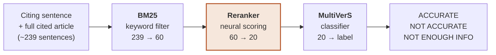

<div align="center">

# CiteAudit

**Does this citation say what its source said?**

An open, fully reproducible pipeline for checking biomedical citations against the full text of the paper they cite.

[](https://www.python.org/)
[](https://pytorch.org/)
[](https://huggingface.co/docs/transformers)
[](#roadmap)
[](https://www.usc.edu/)

[The problem](#the-problem) · [Results](#results) · [Quick start](#quick-start) · [Repository layout](#repository-layout) · [Roadmap](#roadmap) · [Credits](#credits)

</div>

---

## The problem

When a biomedical paper cites another, it claims the source backs up a specific statement. Often it doesn't: the claim gets stretched, flipped, or was never there. In the [Sarol et al. (2024)](https://doi.org/10.1093/bioinformatics/btae420) benchmark, a large share of citations misrepresent their source, and checking them by hand is slow.

CiteAudit takes a **citing sentence** and the **full cited article**, finds the few sentences that could support it, and labels the citation:

| Label | Meaning |
|---|---|
| ✅ **ACCURATE** | The source supports the claim, directly or indirectly. |
| ❌ **NOT ACCURATE** | The source contradicts, oversimplifies, misquotes or fails to substantiate the claim. |
| ➖ **NOT ENOUGH INFO** | The citation is irrelevant to what the source says. |

**Why it is hard.** A cited article has about 239 sentences on average, and only about 2.5 of them are real evidence. The classifier only ever sees the 20 sentences that retrieval keeps, so every evidence sentence retrieval misses is lost for good.

## How it works



| Stage | Sarol et al. 2024 | CiteAudit |
|---|---|---|
| Filter | BM25, top 60 | BM25, same settings |
| **Rerank** | MonoT5-base, zero-shot, general domain, scores each sentence alone | **PubMedBERT cross-encoder**, fine-tuned on this task, scores each sentence with its neighbours |
| Classify | Fine-tuned MultiVerS (Longformer-large) | Same released checkpoint |

## Results

Every number below was measured in this repository. None are copied from the paper. Metrics use the paper's definitions: Recall@k is pooled over all gold evidence sentences, and MRR (mean reciprocal rank) is averaged over all citations with ranks cut off at 20.

### Retrieval, test split (20 articles, 606 citations)

| System | Recall@1 | Recall@5 | Recall@10 | Recall@20 | MRR | AllGold@20 |
|---|---|---|---|---|---|---|
| *Paper, published* | *0.09* | *0.28* | *0.40* | *0.53* | *0.32* | — |
| BM25 only | 0.080 | 0.220 | 0.319 | 0.444 | 0.257 | 0.290 |
| BM25 + MonoT5, paper's pipeline | 0.100 | 0.298 | 0.422 | 0.529 | 0.323 | 0.372 |
| **BM25 + PubMedBERT, ours** ⏳ | 0.119 | 0.385 | **0.523** | **0.638** | **0.365** | **0.493** |

AllGold@20 is the share of citations whose complete gold evidence lands in the top 20.

> **Reproduction status.** The first two rows were re-run independently on an Apple M4 and match the team's original measurements to floating-point precision. The reranker row marked ⏳ is the team's original measurement and is being re-run now. See [`repro/`](repro/) for the scripts and logs.

The reranker gain is **+0.109 Recall@20** over the paper's pipeline, with a 95% CI of +0.084 to +0.131. It wins on 17 of 20 test articles. Ablations trace it to three ingredients: neighbour-sentence context, fine-tuning on this task, and a biomedical encoder. Swapping the model architecture alone contributes nothing. The full analysis is in [`results/week2_retrieval_findings.md`](results/week2_retrieval_findings.md).

### Classification, dev split (316 citations)

| Evidence fed to the released classifier | Evidence recall | Accuracy | Macro-F1 |
|---|---|---|---|
| Random sentences | 0.119 | 0.487 | 0.473 |
| Paper's retrieval | 0.534 | **0.677** | **0.684** |
| Our retrieval | 0.643 | 0.674 | 0.674 |
| Perfect gold evidence | 1.000 | 0.655 | 0.656 |

**Key finding: better retrieval does not improve classification under the frozen released classifier.** Even perfect evidence doesn't help. Random evidence hurts a lot, so the classifier does read its evidence. The most likely explanation is that the classifier is fitted to the evidence distribution it was trained on. Retraining it on our reranker's output is the open experiment.

> These dev-split figures are the team's original measurements and are being re-run now.

## Quick start

**Requirements.** Python 3.11, about 15 GB of disk, and a GPU: Apple Silicon (MPS) or NVIDIA CUDA. Everything below runs on a 16 GB Apple M4.

```bash
git clone https://github.com/SapnilPatel/CiteAudit.git
cd CiteAudit

# 1. Environment
python3.11 -m venv .venv && source .venv/bin/activate
pip install -r requirements-local.txt -r requirements-ml.txt

# 2. Official data and code from the paper's authors
bash bootstrap.sh
unzip -q upstream/Citation-Integrity/Data/annotations.zip -d upstream/annotations_extracted -x "__MACOSX/*"
for s in train dev test; do
  python scripts/align_annotations.py --split $s --out results/annotations/$s.jsonl
done

# 3. Retrieval baselines (BM25 takes seconds; MonoT5 about 15 minutes on an M4)
python scripts/retrieval_harness.py --split test
python scripts/retrieval_harness.py --split test --ranker bm25-monot5
```

To reproduce **everything**, download the authors' released MultiVerS checkpoint (5.25 GB) and their classifier input from their [Google Drive folder](https://drive.google.com/drive/folders/11b6Z8iv2FXObWmLaqfYzgUQsaL4QgTT2) into `checkpoints/drive/`, then run:

```bash
bash repro/run_retrieval.sh        # paper pipeline + train and score our reranker, about 1.5 hours
bash repro/run_classification.sh   # 10 evidence settings through the classifier, about 1 hour
```

<details>
<summary><b>Training the reranker on its own</b></summary>

```bash
# The recipe is 1 epoch and 4 negatives. Pass these explicitly:
# the script's defaults (2 epochs, 7 negatives) are a worse setting.
python scripts/train_reranker.py --epochs 1 --negatives 4 --groups-per-batch 4 \
  --out checkpoints/ce --predict dev --rankings-out results/retrieval/dev_ce.jsonl
python scripts/retrieval_harness.py --split dev --ranker file --rankings-in results/retrieval/dev_ce.jsonl

# On an NVIDIA GPU, mixed precision and a larger batch both help
python scripts/train_reranker.py --epochs 1 --negatives 4 --groups-per-batch 8 --amp \
  --out checkpoints/ce --predict dev --rankings-out results/retrieval/dev_ce.jsonl
```

</details>

<details>
<summary><b>Comparing two runs properly</b></summary>

With only 10 to 20 articles per split, two independent confidence intervals overlap even when one system wins on most articles. Use the paired, article-level bootstrap instead:

```bash
# pass the variant first, so delta reads as variant minus baseline
python scripts/compare_runs.py results/retrieval/variant.jsonl results/retrieval/baseline.jsonl --metric Recall@20
```

</details>

## Repository layout

```text
CiteAudit/
├── scripts/                  # the pipeline
│   ├── retrieval_harness.py      # BM25 and BM25+MonoT5 retrieval, metrics with bootstrap CIs
│   ├── train_reranker.py         # fine-tunes the PubMedBERT cross-encoder
│   ├── align_annotations.py      # joins the raw annotations to claim ids
│   ├── export_for_multivers.py   # builds classifier input from rankings (incl. oracle/random arms)
│   ├── predict_multivers.py      # runs the released MultiVerS checkpoint on modern PyTorch
│   ├── score_multivers.py        # F1 and paired McNemar tests between arms
│   └── compare_runs.py           # paired comparison of two retrieval runs
├── repro/                    # independent re-run of every result, with scripts and metrics
├── results/                  # metrics, findings report and results tables
│   ├── week2_retrieval_findings.md   # full analysis, sections 1 to 11
│   └── retrieval/                    # per-run metrics JSON
├── data_train/target/        # classifier inputs for each evidence setting (dev)
├── tests/                    # offline tests
├── docs/team/                # the original team plan and working notes
└── slides/                   # progress presentation
```

## Known caveats

- **The authors' prediction script does not run as shipped.** It needs a config file that isn't in their repository and hardcodes its data path. [`scripts/predict_multivers.py`](scripts/predict_multivers.py) reimplements the label path against the released checkpoint.
- **The 3-way labels need the raw annotations.** About 14% of dev citations get the wrong label if you derive it from the claims files alone.
- **The dataset has 9 fine-grained labels, not the 8 the paper lists.** The extra one, `INDIRECT_NOT_REVIEW`, is mapped to ACCURATE here.
- **Classification numbers are dev-split.** They are not directly comparable to the paper's test-split figures.

## Roadmap

- [x] Reproduce the paper's retrieval stage
- [x] Train a reranker that beats it on all metrics
- [x] Run the released classifier on random, retrieved and perfect evidence
- [ ] Independently re-run every result in this repository ⏳
- [ ] Retrain MultiVerS on our reranker's output, which needs a CUDA GPU
- [ ] Error analysis of classifier decisions before and after retraining
- [ ] A one-command `citeaudit check` interface for researchers

## Credits

CiteAudit started as the course project of **CSCI 544 (Applied Natural Language Processing), Group 23, University of Southern California**. The original reproduction toolkit, the reranker and the findings report were built by [ruidaliu](https://github.com/liuruida200-liu) in [CSCI544_Group23_Weeks1_2_Reproduction_Toolkit](https://github.com/liuruida200-liu/CSCI544_Group23_Weeks1_2_Reproduction_Toolkit). That history is preserved here.

It builds directly on:

- **Citation-Integrity** by ScienceNLP-Lab, the dataset and baseline. [GitHub](https://github.com/ScienceNLP-Lab/Citation-Integrity), MIT License.
- **MultiVerS** by David Wadden et al., the classifier. [GitHub](https://github.com/dwadden/multivers), MIT License.
- **MonoT5** by Castorini, and **PubMedBERT** by Microsoft Research, through Hugging Face.

If you use this work, please cite the original benchmark:

```bibtex
@article{sarol2024citation,
  title   = {Assessing citation integrity in biomedical publications: corpus annotation and NLP models},
  author  = {Sarol, Maria Janina and Ming, Shufan and Radhakrishna, Shruthan and Schneider, Jodi and Kilicoglu, Halil},
  journal = {Bioinformatics},
  volume  = {40},
  number  = {7},
  pages   = {btae420},
  year    = {2024},
  doi     = {10.1093/bioinformatics/btae420}
}
```

## License

A license has not been chosen yet. Until one is added, all rights are reserved by the contributors. MIT is recommended to match both upstream projects.
