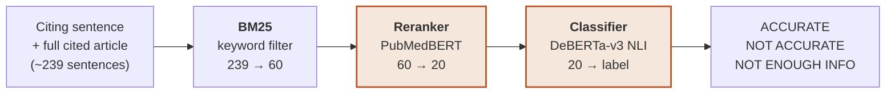

<div align="center">

# CiteAudit

**Does this citation say what its source said?**

An open tool that checks citations in biomedical papers against the full text of the paper they cite, and the fully reproducible research behind it.

[](https://github.com/SapnilPatel/CiteAudit/actions/workflows/tests.yml)
[](https://www.python.org/)
[](https://huggingface.co/Sapnil)
[](LICENSE)
[](https://www.usc.edu/)

[Use it](#use-it) · [How it works](#how-it-works) · [Results](#results) · [What we tried](#what-we-tried) · [Reproduce](#reproduce-the-research) · [Credits](#credits)

</div>

---

## The problem

When a biomedical paper cites another, it claims the source backs up a specific statement. Often it doesn't: the claim gets stretched, flipped, or was never there. In the [Sarol et al. (2024)](https://doi.org/10.1093/bioinformatics/btae420) benchmark, a large share of citations misrepresent their source, and checking them by hand is slow.

CiteAudit takes a **citing sentence** and the **full cited article**, finds the few sentences that could support it, and labels the citation:

| Label | Meaning |
|---|---|
| ✅ **ACCURATE** | The source supports the claim, directly or indirectly. |
| ❌ **NOT ACCURATE** | The source contradicts, oversimplifies, misquotes or fails to substantiate the claim. |
| ➖ **NOT ENOUGH INFO** | The citation is irrelevant to what the source says. |

**Why it is hard.** A cited article has about 239 sentences on average, and only about 2.5 of them are real evidence. The classifier only ever sees the 20 sentences that retrieval keeps, so every evidence sentence retrieval misses is lost for good.

## Use it

```bash
pip install "citeaudit[pdf] @ git+https://github.com/SapnilPatel/CiteAudit"
```

Check one citation against the paper it cites. The paper can be a PDF, a text file, or an open-access PubMed Central id:

```bash
citeaudit check --paper cited_paper.pdf --citing "Statins reduce all-cause mortality in older adults [12]."
citeaudit check --pmcid PMC3643595 --citing "loc285194 is a p53-regulated tumor suppressor [4]."
```

CiteAudit prints the label, the probability of each label, and the sentences of the cited paper it based the decision on, so you can check them yourself. Citation markers such as `[12]` or `(Smith et al., 2020)` are removed before checking.

To check many citations, put one JSON object per line, each with `citing` and the cited paper as `paper` (a path), `pmcid`, `text` or `sentences`:

```bash
citeaudit check --batch citations.jsonl --out results.jsonl
```

From Python:

```python
from citeaudit import CiteAuditor

auditor = CiteAuditor()            # downloads both models on first use (about 1.3 GB)
result = auditor.check("Statins reduce all-cause mortality in older adults [12].",
                       paper_text=open("cited_paper.txt").read())
print(result.label, result.probabilities)
for e in result.evidence[:3]:
    print(e.score, e.sentence)
```

It runs on a CPU (a few seconds per citation), an NVIDIA GPU, or Apple Silicon. **About a third of its decisions are wrong** (see [Results](#results)): use it to decide which citations a person should read closely, not as a verdict.

## How it works



| Stage | Sarol et al. 2024 | CiteAudit |
|---|---|---|
| Filter | BM25, top 60 | BM25, same settings |
| **Rerank** | MonoT5-base, zero-shot, general domain, scores each sentence alone | **PubMedBERT cross-encoder**, fine-tuned on this task, scores each sentence with its neighbours |
| **Classify** | MultiVerS (Longformer-large), fine-tuned | **DeBERTa-v3-large NLI model**, fine-tuned, with its entailment / contradiction / neutral head kept as ACCURATE / NOT ACCURATE / NOT ENOUGH INFO |

Why an NLI model: 76% of the remaining errors of our best earlier system were faithfulness judgements on evidence that had been retrieved ([`results/diagnosis_v1.md`](results/diagnosis_v1.md)). Judging whether a statement follows from a text is exactly what NLI models are trained on, using about a million examples, while this task has 2141.

Both models are on the Hugging Face Hub: [`citeaudit-reranker`](https://huggingface.co/Sapnil/citeaudit-reranker) and [`citeaudit-nli`](https://huggingface.co/Sapnil/citeaudit-nli).

## Results

Every number below was measured in this repository. None are copied from the paper. All results are on the Citation-Integrity **test split: 20 articles and 606 citations**, unseen during development. Every choice was made by cross-validation on train or on the dev split.

### Classification

| System (test, 606 citations) | Accuracy | Macro-F1 | ACCURATE F1 | NOT ACCURATE F1 | NOT ENOUGH INFO F1 |
|---|---|---|---|---|---|
| *Sarol et al. 2024, published* | *0.59* | *0.52* | *0.69* | *0.43* | *0.42* |
| Sarol et al. 2024, reproduced here | 0.584 | 0.524 | 0.692 | 0.426 | 0.455 |
| Our earlier best: MultiVerS + BiomedBERT ensemble | 0.642 | 0.538 | 0.764 | 0.426 | 0.424 |
| **CiteAudit**, one model (mean ± sd of 3 training seeds) | **0.668 ± 0.015** | **0.556 ± 0.015** | — | — | — |
| **CiteAudit**, 3 seeds averaged | **0.680** | **0.575** | **0.796** | **0.439** | **0.490** |

Against the reproduced paper system, CiteAudit is right on 134 citations the paper's system gets wrong, and wrong on 76 it gets right: **+9.6 points of accuracy, McNemar exact p = 0.00008**. Macro-F1 rises by 0.050, with a paired bootstrap 95% CI of −0.009 to +0.111, so the macro-F1 gain is not yet conclusive. Each training seed on its own beats the paper's system on both metrics. Details: [`results/nli_classifier_v1.md`](results/nli_classifier_v1.md).

**What it still gets wrong.** NOT ACCURATE F1 is 0.44, barely above the paper's 0.43. The gains come from recognising accurate citations and irrelevant ones. Telling a subtly overstated or unsupported citation from a faithful one is still the hard, open part of the problem.

### Retrieval

| System (test) | Recall@1 | Recall@5 | Recall@10 | Recall@20 | MRR | AllGold@20 |
|---|---|---|---|---|---|---|
| *Paper, published* | *0.09* | *0.28* | *0.40* | *0.53* | *0.32* | — |
| BM25 only | 0.080 | 0.220 | 0.319 | 0.444 | 0.257 | 0.290 |
| BM25 + MonoT5, paper's pipeline | 0.100 | 0.298 | 0.422 | 0.529 | 0.323 | 0.372 |
| BM25 + PubMedBERT, ours (original run) | 0.119 | 0.385 | **0.523** | **0.638** | 0.365 | **0.493** |
| BM25 + PubMedBERT, independent retrain (released) | 0.124 | 0.385 | 0.510 | 0.627 | **0.379** | **0.493** |

Recall@k is pooled over all gold evidence sentences and MRR is cut off at rank 20, both as in the paper. AllGold@20 is the share of citations whose complete gold evidence lands in the top 20. The reranker gains **+0.109 Recall@20** over the paper's pipeline (95% CI +0.084 to +0.131) and wins on 17 of 20 test articles. Full analysis: [`results/week2_retrieval_findings.md`](results/week2_retrieval_findings.md).

## What we tried

Improving on the paper took many experiments, and most of them did not help. All of them are recorded, with the data and logs:

| Idea | Result | Write-up |
|---|---|---|
| Feed the paper's classifier better evidence (ours, or perfect gold evidence) | No gain: even perfect evidence does not help the released MultiVerS | [`repro/`](repro/) |
| Fine-tune MultiVerS on our evidence | No gain | [`multivers_finetune_v1.md`](results/multivers_finetune_v1.md) |
| Train a BiomedBERT classifier on our evidence (3- and 9-label) | Higher accuracy (0.662) but lower macro-F1 (0.489) | [`classifier_v3.md`](results/classifier_v3.md) |
| Ensemble MultiVerS with BiomedBERT | 0.642 / 0.538, our best before NLI | [`ensemble_v1.md`](results/ensemble_v1.md) |
| Open LLMs: Qwen2.5-7B zero-shot, Qwen2.5-3B fine-tuned with QLoRA | Macro-F1 0.39 for both | [`llm_zero_shot_v1.md`](results/llm_zero_shot_v1.md), [`llm_finetune_v1.md`](results/llm_finetune_v1.md) |
| Give the classifier the citing paragraph, not just the sentence | Worse: CV macro-F1 0.428 → 0.378 / 0.358 | [`classifier_v4.md`](results/classifier_v4.md) |
| **NLI-pretrained classifier (DeBERTa-v3-large)** | **CV macro-F1 0.428 → 0.570; best on test** | [`nli_classifier_v1.md`](results/nli_classifier_v1.md) |
| Ensemble the NLI model with MultiVerS | Worse on test (0.552) | [`nli_classifier_v1.md`](results/nli_classifier_v1.md) |
| Intermediate training on 15.6k human-labelled biomedical claims (HealthVer, SciFact), and reading all 20 sentences (1024 tokens) | Same as the NLI model, within noise (CV macro-F1 0.570, test 0.580 against 0.575) | [`nli_biomed_v1.md`](results/nli_biomed_v1.md) |
| Train on ~1000 LLM-written misrepresentations of accurate citations | Better at misrepresentations, worse at accurate citations; no net gain | [`synthetic_v1.md`](results/synthetic_v1.md), [`synthetic_v2.md`](results/synthetic_v2.md) |

The error analysis that led to the NLI model is in [`results/error_analysis.md`](results/error_analysis.md) and [`results/diagnosis_v1.md`](results/diagnosis_v1.md).

## Reproduce the research

**Requirements.** Python 3.11, about 15 GB of disk, and a GPU: Apple Silicon (MPS) or NVIDIA CUDA. Retrieval and the reproduction run on a 16 GB Apple M4. The classifier experiments ran on a free Colab T4: each has a notebook in [`notebooks/`](notebooks/) that clones this repository, runs, and saves its results to Google Drive.

```bash
git clone https://github.com/SapnilPatel/CiteAudit.git
cd CiteAudit

# 1. Environment
python3.11 -m venv .venv && source .venv/bin/activate
pip install -r requirements-local.txt -r requirements-ml.txt

# 2. Official data and code from the paper's authors
bash bootstrap.sh
unzip -q upstream/Citation-Integrity/Data/annotations.zip -d upstream/annotations_extracted -x "__MACOSX/*"
for s in train dev test; do
  python scripts/align_annotations.py --split $s --out results/annotations/$s.jsonl
done

# 3. Retrieval baselines (BM25 takes seconds; MonoT5 about 15 minutes on an M4)
python scripts/retrieval_harness.py --split test
python scripts/retrieval_harness.py --split test --ranker bm25-monot5
```

To reproduce **everything**, download the authors' released MultiVerS checkpoint (5.25 GB) and their classifier input from their [Google Drive folder](https://drive.google.com/drive/folders/11b6Z8iv2FXObWmLaqfYzgUQsaL4QgTT2) into `checkpoints/drive/`, then run:

```bash
bash repro/run_retrieval.sh        # paper pipeline + train and score our reranker, about 1.5 hours
bash repro/run_classification.sh   # 10 evidence settings through the classifier, about 1 hour
```

<details>
<summary><b>Training the reranker on its own</b></summary>

```bash
# The recipe is 1 epoch and 4 negatives. Pass these explicitly:
# the script's defaults (2 epochs, 7 negatives) are a worse setting.
python scripts/train_reranker.py --epochs 1 --negatives 4 --groups-per-batch 4 \
  --out checkpoints/ce --predict dev --rankings-out results/retrieval/dev_ce.jsonl
python scripts/retrieval_harness.py --split dev --ranker file --rankings-in results/retrieval/dev_ce.jsonl

# On an NVIDIA GPU, mixed precision and a larger batch both help
python scripts/train_reranker.py --epochs 1 --negatives 4 --groups-per-batch 8 --amp \
  --out checkpoints/ce --predict dev --rankings-out results/retrieval/dev_ce.jsonl
```

</details>

<details>
<summary><b>Comparing two runs properly</b></summary>

With only 10 to 20 articles per split, two independent confidence intervals overlap even when one system wins on most articles. Use the paired, article-level bootstrap instead:

```bash
# pass the variant first, so delta reads as variant minus baseline
python scripts/compare_runs.py results/retrieval/variant.jsonl results/retrieval/baseline.jsonl --metric Recall@20
```

</details>

## Repository layout

```text
CiteAudit/
├── citeaudit/                # the installable tool: retrieval, classifier, CLI
├── scripts/                  # the research pipeline
│   ├── retrieval_harness.py      # BM25 and BM25+MonoT5 retrieval, metrics with bootstrap CIs
│   ├── train_reranker.py         # fine-tunes the PubMedBERT cross-encoder
│   ├── train_nli.py              # fine-tunes the NLI classifier (CV, seeds, export)
│   ├── train_classifier.py       # BiomedBERT classifier baseline
│   ├── predict_multivers.py      # runs the released MultiVerS checkpoint on modern PyTorch
│   ├── ensemble_classifiers.py   # probability ensembles with paired significance tests
│   ├── error_analysis.py         # per-label, per-article, per-coverage error breakdown
│   └── generate_misrep.py, clean_misrep.py   # the synthetic-data experiment
├── notebooks/                # one Colab notebook per GPU experiment, plus the release model
├── release/                  # model cards for the Hugging Face Hub
├── repro/                    # independent re-run of every retrieval and reproduction result
├── results/                  # every experiment's write-up, metrics and run configs
├── data_train/               # classifier inputs, fine-grained labels, citing context, synthetic data
└── tests/                    # offline tests, run by CI
```

## Known caveats

- **The authors' prediction script does not run as shipped.** It needs a config file that isn't in their repository and hardcodes its data path. [`scripts/predict_multivers.py`](scripts/predict_multivers.py) reimplements the label path against the released checkpoint.
- **The 3-way labels need the raw annotations.** About 14% of dev citations get the wrong label if you derive it from the claims files alone.
- **The dataset has 9 fine-grained labels, not the 8 the paper lists.** The extra one, `INDIRECT_NOT_REVIEW`, is mapped to ACCURATE here.
- **The authors' released classifier input is a top-5 setting.** On test it gives macro-F1 0.444, which does not correspond to any figure in the paper. Details in [`repro/`](repro/).

## Roadmap

- [x] Reproduce the paper's retrieval stage and its top-20 test classification figures
- [x] Train a reranker that beats it on all retrieval metrics
- [x] Independently re-run every result in this repository
- [x] Error analysis of classifier decisions
- [x] A classifier that beats the paper on test (accuracy +9.6 points, p < 0.001)
- [x] A one-command `citeaudit check` tool, with models on the Hugging Face Hub
- [ ] Better detection of misrepresenting citations (NOT ACCURATE F1 is still 0.44)

## Credits

CiteAudit started as a course project for **CSCI 544 (Applied Natural Language Processing) at the University of Southern California**.

It builds directly on:

- **Citation-Integrity** by ScienceNLP-Lab, the dataset and baseline. [GitHub](https://github.com/ScienceNLP-Lab/Citation-Integrity), MIT License.
- **MultiVerS** by David Wadden et al., the paper's classifier. [GitHub](https://github.com/dwadden/multivers), MIT License.
- **MonoT5** by Castorini, **PubMedBERT** by Microsoft Research, and **DeBERTa-v3-large-mnli-fever-anli-ling-wanli** by Moritz Laurer, through Hugging Face.

If you use this work, please cite the original benchmark:

```bibtex
@article{sarol2024citation,
  title   = {Assessing citation integrity in biomedical publications: corpus annotation and NLP models},
  author  = {Sarol, Maria Janina and Ming, Shufan and Radhakrishna, Shruthan and Schneider, Jodi and Kilicoglu, Halil},
  journal = {Bioinformatics},
  volume  = {40},
  number  = {7},
  pages   = {btae420},
  year    = {2024},
  doi     = {10.1093/bioinformatics/btae420}
}
```

## License

[MIT](LICENSE), matching both upstream projects. The dataset and the released MultiVerS checkpoint keep their authors' own terms.
